<p align="center">
  
</p>

# PARADIGMAS DE PROGRAMACIÓN
### (3646 - 2900) — 2do Cuatrimestre - 2026

---

## Trabajo Práctico N° 2: El Torneo de los Inmortales
**La elección de los Dos Santos Supremos**

### Equipo Docente
- **Profesor Titular:** Gasior, Federico Mauro
- **Profesor Adjunto:** Lanzilotta, Hernán Gabriel

### Integrantes del Grupo
- **Avila García, Eric Luis**
- **Faulkner, Christian David**
- **Palacios, Joaquín Tomás**
- **Diaz, Nicolas**
- **Cornara Perez, Tomás Andrés**

---

## Índice

1. [Introducción](#1-introducción)
   - 1.1. [Contexto y Problemática](#11-contexto-y-problemática)
   - 1.2. [Objetivos del Trabajo](#12-objetivos-del-trabajo)
2. [Arquitectura y Diseño del Sistema](#2-arquitectura-y-diseño-del-sistema)
   - 2.1. [Diagrama de Clases UML](#21-diagrama-de-clases-uml)
   - 2.2. [Modularización por Paquetes](#22-modularización-por-paquetes)
3. [Desarrollo del Modelo de Dominio](#3-desarrollo-del-modelo-de-dominio)
   - 3.1. [Combatientes y Polimorfismo Puro](#31-combatientes-y-polimorfismo-puro)
   - 3.2. [Creación Centralizada y Principio Abierto/Cerrado (OCP)](#32-creación-centralizada-y-principio-abiertocerrado-ocp)
   - 3.3. [Escuelas de Cultivación](#33-escuelas-de-cultivación)
   - 3.4. [Técnicas de Combate y Efectos Temporales (Bonus)](#34-técnicas-de-combate-y-efectos-temporales-bonus)
   - 3.5. [Sistema de Equipamiento y Restricciones](#35-sistema-de-equipamiento-y-restricciones)
   - 3.6. [Parejas y Reglas del Combate](#36-parejas-y-reglas-del-combate)
   - 3.7. [Gestión del Torneo y Determinismo](#37-gestión-del-torneo-y-determinismo)
   - 3.8. [Patrón Observer: Acontecimientos, Heraldo y Cronista](#38-patrón-observer-acontecimientos-heraldo-y-cronista)
   - 3.9. [Criterio en la Selección de Colecciones](#39-criterio-en-la-selección-de-colecciones)
4. [Estrategia de Verificación y Pruebas Unitarias](#4-estrategia-de-verificación-y-pruebas-unitarias)
   - 4.1. [Mapeo de Reglas de la Consigna vs. Tests Unitarios](#41-mapeo-de-reglas-de-la-consigna-vs-tests-unitarios)
   - 4.2. [Resultados de la Suite de Pruebas](#42-resultados-de-la-suite-de-pruebas)
5. [Conclusiones](#5-conclusiones)
6. [Referencias](#6-referencias)

---

## 1. Introducción

### 1.1. Contexto y Problemática
En el marco de la asignatura Paradigmas de Programación de la Universidad Nacional de La Matanza (UNLaM), el presente trabajo práctico aborda la resolución de una problemática compleja mediante la aplicación integral de los principios del **Paradigma Orientado a Objetos (POO)** en lenguaje Java.

La temática propuesta, *"El Torneo de los Inmortales: la elección de los Dos Santos Supremos"*, modela un certamen marcial por eliminación directa disputado por parejas de combatientes pertenecientes a distintas escuelas de cultivación. El escenario plantea desafíos de diseño significativos:
- Coexistencia de diversas disciplinas marciales que modifican las reglas básicas de cálculo de daño, mitigación defensiva y costos de energía.
- Modificación dinámica de atributos mediante equipamiento con restricciones de categorías y cupos.
- Reglas tácticas deterministas de toma de decisiones en combates por asaltos y turnos (selección de objetivos, priorización de habilidades y restricciones entre compañeros).
- Desacoplamiento total entre las reglas de negocio, la recolección histórica de métricas y la capa de presentación visual.

### 1.2. Objetivos del Trabajo
1. Modelar un dominio robusto aplicando abstracción, encapsulamiento, herencia, polimorfismo e interfaces.
2. Evitar estructuras condicionales rígidas (`if-else`, `switch` o comprobaciones de tipos con `instanceof`) para gobernar las variantes de comportamiento de los combatientes.
3. Aplicar patrones de diseño reconocidos en la industria, tales como **Observer** (para la emisión y registro de acontecimientos) y **Factory / Registry** (para la instanciación centralizada y extensible de combatientes).
4. Emplear las colecciones de Java (`List`, `Set`, `Map`) fundamentadas en la semántica requerida por cada regla del negocio.
5. Garantizar la confiabilidad y reproducibilidad del sistema mediante una rigurosa batería de pruebas unitarias construida sobre JUnit 5.
6. Respetar la premisa académica de evitar la sobreingeniería, privilegiando la simplicidad, la claridad estructural y la alta cohesión con bajo acoplamiento.

---

## 2. Arquitectura y Diseño del Sistema

### 2.1. Diagrama de Clases UML

El siguiente diagrama modela la estructura general del sistema, sus relaciones de herencia, realización de interfaces y composición:

```mermaid
classDiagram
    %% Paquete combatientes
    class Combatiente {
        <<abstract>>
        -int id
        -String nombre
        -Escuela escuela
        -int vidaActual
        -int energiaActual
        -List~Equipamiento~ equipamientos
        -Map~Tecnica, Integer~ usosRestantes
        -List~Tecnica~ defensasActivas
        -int reduccionDefensaActiva
        -List~EfectoTemporal~ efectosTemporales
        +id() int
        +nombre() String
        +escuela() Escuela
        +vidaActual() int
        +energiaActual() int
        +vidaMaxima() int
        +energiaMaxima() int
        +estaEnPie() boolean
        +tipo()* String
        +calcularDanioAtaque(int danioBase) int
        +recibirDanio(int danioEntrante) void
        +calcularCostoEnergia(Tecnica tecnica) int
        +curar(int cantidad) void
        +consumirEnergia(int cantidad) void
        +recuperarEnergia(int cantidad) void
        +equipar(Equipamiento objeto) void
        +desequipar(CategoriaEquipamiento categoria) void
        +usosRestantes(Tecnica tecnica) int
        +descontarUso(Tecnica tecnica) void
        +puedeEjecutarTecnica(Tecnica tecnica, Pareja pareja) boolean
        +seleccionarTecnica(Pareja pareja) Tecnica
        +restablecerCombate() void
        +procesarEfectosAlInicioTurno(EmisorAcontecimientos emisor) void
    }

    class CultivadorDeLaEspada {
        +tipo() String
        +calcularDanioAtaque(int danioBase) int
    }
    class MonjeDelCuerpoCelestial {
        +tipo() String
        +recibirDanio(int danioEntrante) void
    }
    class HechiceroDelVacio {
        +tipo() String
        +calcularCostoEnergia(Tecnica tecnica) int
    }

    Combatiente <|-- CultivadorDeLaEspada
    Combatiente <|-- MonjeDelCuerpoCelestial
    Combatiente <|-- HechiceroDelVacio

    class Escuela {
        -String nombre
        -List~Tecnica~ tecnicas
        -List~Equipamiento~ equipamientos
        +nombre() String
        +tecnicas() List~Tecnica~
        +equipamientos() List~Equipamiento~
    }

    class CreadorCombatientes {
        -int siguienteId
        -Map~String, FabricaCombatiente~ fabricas
        +registrarTipo(String nombreTipo, FabricaCombatiente fabrica) void
        +crear(String tipo, String nombre, Escuela escuela) Combatiente
        +crear(TipoCombatiente tipo, String nombre, Escuela escuela) Combatiente
    }

    Combatiente --> Escuela : configurado por
    CreadorCombatientes ..> Combatiente : crea

    %% Paquete equipamiento
    class Equipamiento {
        <<interface>>
        +nombre() String
        +categoria() CategoriaEquipamiento
        +modificadorDanio() int
        +modificadorDefensa() int
        +modificadorVidaMaxima() int
        +modificadorEnergiaMaxima() int
    }

    class CategoriaEquipamiento {
        <<enumeration>>
        ARMA
        ARMADURA
        ANILLO
        SELLO
    }

    class EspadaCelestial {
        +nombre() String
        +categoria() CategoriaEquipamiento
        +modificadorDanio() int
    }
    class ArmaduraDorada {
        +nombre() String
        +categoria() CategoriaEquipamiento
        +modificadorDefensa() int
    }
    class AnilloEspiritual {
        +nombre() String
        +categoria() CategoriaEquipamiento
        +modificadorEnergiaMaxima() int
    }
    class SelloDelFenix {
        +nombre() String
        +categoria() CategoriaEquipamiento
        +modificadorVidaMaxima() int
    }

    Equipamiento <|.. EspadaCelestial
    Equipamiento <|.. ArmaduraDorada
    Equipamiento <|.. AnilloEspiritual
    Equipamiento <|.. SelloDelFenix
    Equipamiento --> CategoriaEquipamiento
    Combatiente o-- Equipamiento : porta 0..3

    %% Paquete tecnicas
    class Tecnica {
        <<interface>>
        +nombre() String
        +costoEnergia() int
        +tipo() TipoTecnica
        +ejecutar(ContextoEjecucion contexto) void
    }

    class TipoTecnica {
        <<enumeration>>
        OFENSIVA
        DEFENSIVA
        RECUPERACION
    }

    class TecnicaBase {
        <<abstract>>
        +equals(Object o) boolean
        +hashCode() int
        +toString() String
    }

    Tecnica <|.. TecnicaBase
    Tecnica --> TipoTecnica

    class CorteDeLosMilAmaneceres {
        +ejecutar(ContextoEjecucion contexto) void
    }
    class DominioDeLaNada {
        +ejecutar(ContextoEjecucion contexto) void
    }
    class MeditacionDelInmortal {
        +ejecutar(ContextoEjecucion contexto) void
    }
    class MuroDelCuerpoDorado {
        +ejecutar(ContextoEjecucion contexto) void
    }
    class GolpeVenenoso {
        +ejecutar(ContextoEjecucion contexto) void
    }
    class RegeneracionVital {
        +ejecutar(ContextoEjecucion contexto) void
    }

    TecnicaBase <|-- CorteDeLosMilAmaneceres
    TecnicaBase <|-- DominioDeLaNada
    TecnicaBase <|-- MeditacionDelInmortal
    TecnicaBase <|-- MuroDelCuerpoDorado
    TecnicaBase <|-- GolpeVenenoso
    TecnicaBase <|-- RegeneracionVital

    class EfectoTemporal {
        <<abstract>>
        -int turnosRestantes
        +aplicarAlInicioTurno(Combatiente c) void
        +haTerminado() boolean
        #aplicarEfecto(Combatiente c)* void
    }
    class Veneno {
        -int danioPorTurno
        #aplicarEfecto(Combatiente c) void
    }
    class Regeneracion {
        -int curacionPorTurno
        #aplicarEfecto(Combatiente c) void
    }
    EfectoTemporal <|-- Veneno
    EfectoTemporal <|-- Regeneracion
    Combatiente *-- EfectoTemporal

    %% Paquete torneo
    class Pareja {
        -int id
        -Combatiente primero
        -Combatiente segundo
        -Map~Tecnica, Combatiente~ tecnicaUsadaPor
        +id() int
        +combatientes() List~Combatiente~
        +sigueEnPie() boolean
        +vidaTotal() int
        +registrarUsoTecnica(Combatiente usuario, Tecnica tecnica) void
        +puedeUsarPorReglaCompaniero(Combatiente solicitante, Tecnica tecnica) boolean
        +reiniciarRestriccionesCombate() void
        +restablecerParaNuevoCombate() void
    }

    class Combate {
        -Pareja pareja1
        -Pareja pareja2
        -int ronda
        -int limiteAsaltos
        -EmisorAcontecimientos emisor
        +resolver() Pareja
    }

    class Torneo {
        -List~Pareja~ parejas
        -Set~Pareja~ parejasInscriptas
        -Set~Combatiente~ combatientesInscriptos
        -EmisorAcontecimientos emisor
        +inscribir(Pareja pareja) void
        +iniciar() Pareja
    }

    Pareja *-- Combatiente : conformada por 2
    Combate --> Pareja : enfrenta
    Torneo o-- Pareja : gestiona 4 u 8

    %% Paquete acontecimientos
    class Acontecimiento {
        <<interface>>
        +descripcion() String
    }
    class EmisorAcontecimientos {
        -List~ObservadorAcontecimientos~ observadores
        +registrarObservador(ObservadorAcontecimientos obs) void
        +notificar(Acontecimiento ac) void
    }
    class ObservadorAcontecimientos {
        <<interface>>
        +notificar(Acontecimiento ac) void
    }
    class HeraldoImperial {
        +notificar(Acontecimiento ac) void
        +presentarTablaPosiciones(List~EntradaTablaPosiciones~ t) void
    }
    class CronistaDeLaSecta {
        -List~Acontecimiento~ historial
        -Map~Pareja, InfoPareja~ tablaParejas
        +notificar(Acontecimiento ac) void
        +obtenerTablaPosiciones() List~EntradaTablaPosiciones~
    }

    EmisorAcontecimientos o-- ObservadorAcontecimientos
    ObservadorAcontecimientos <|.. HeraldoImperial
    ObservadorAcontecimientos <|.. CronistaDeLaSecta
    Combate --> EmisorAcontecimientos
    Torneo --> EmisorAcontecimientos
```



### 2.2. Modularización por Paquetes

El código se organiza en cinco paquetes con responsabilidades unívocas y sin dependencias circulares:

1. **`combatientes`**: Modela a los participantes del torneo, sus arquetipos polimórficos, las escuelas de iniciación y la fábrica centralizada de creación.
2. **`equipamiento`**: Define la interfaz de los objetos que alteran atributos y sus categorías excluyentes (`ARMA`, `ARMADURA`, `ANILLO`, `SELLO`), junto con las excepciones de dominio asociadas.
3. **`tecnicas`**: Modela las técnicas ofensivas, defensivas y curativas, el contexto de ejecución y los efectos temporales (bonus).
4. **`torneo`**: Encapsula las entidades organizativas: parejas, combates por asaltos/turnos y la llave eliminatoria del torneo.
5. **`acontecimientos`**: Implementa el patrón Observer. Aloja los eventos tipados, el emisor y los observadores obligatorios (`HeraldoImperial` y `CronistaDeLaSecta`).

---

## 3. Desarrollo del Modelo de Dominio

### 3.1. Combatientes y Polimorfismo Puro
La clase abstracta `Combatiente` define la estructura inmutable y mutable de cada cultivador. Posee un identificador numérico único e inmutable, nombre, escuela de procedencia, puntos de vida y energía (actuales y máximos), además del listado de equipamiento y técnicas asignadas.

Siguiendo el mandato de la consigna (*"La diferencia entre tipos debe surgir del polimorfismo, no de preguntar el tipo con if o instanceof"*), las especializaciones se resolvieron mediante vinculación dinámica (*dynamic binding*):

- **`CultivadorDeLaEspada`**: Sobreescribe `calcularDanioAtaque(int danioBase)`. Multiplica el daño base por un factor del 30% adicional antes de sumar las bonificaciones de armamento:
  $$\text{Daño} = \text{round}(\text{danioBase} \times 1.30) + \text{bonoDanioEquipamiento}$$
- **`MonjeDelCuerpoCelestial`**: Sobreescribe `recibirDanio(int danioEntrante)`. Aplica una mitigación pasiva del 30% del impacto antes de descontar los bonos de armadura y defensas activas:
  $$\text{Daño Mitigado} = \text{round}(\text{danioEntrante} \times 0.70)$$
- **`HechiceroDelVacio`**: Sobreescribe `calcularCostoEnergia(Tecnica tecnica)`. Aplica un descuento de 8 puntos al costo de ejecución de cualquier técnica, garantizando un piso mínimo de 1 punto de energía:
  $$\text{Costo Final} = \max(1, \text{costoBase} - 8)$$

La identidad de los combatientes depende exclusivamente de su identificador numérico: dos combatientes con el mismo ID son idénticos a través de `equals()` y `hashCode()`, independientemente de sus nombres o estadísticas temporales.

### 3.2. Creación Centralizada y Principio Abierto/Cerrado (OCP)
Para que los clientes del dominio no requieran conocer las clases concretas ni la complejidad de inicialización de atributos, se diseñó `CreadorCombatientes`.

Dicha clase incorpora internamente un registro (`Map<String, FabricaCombatiente>`) que asocia nombres de arquetipos textuales con referencias a constructores (`CultivadorDeLaEspada::new`, etc.). De este modo:
- Se cumple con la signatura requerida en el ejemplo del enunciado:
  ```java
  Combatiente aurelio = creador.crear("Cultivador de la Espada", "Aurelio", escuelaDeLaEspada);
  ```
- Se respeta el principio **Open/Closed** (Abierto/Cerrado): es posible incorporar un nuevo arquetipo (por ejemplo, `"Ninja de las Sombras"`) mediante el método público `registrarTipo(nombre, fabrica)` sin modificar el torneo, el creador ni las técnicas existentes.

### 3.3. Escuelas de Cultivación
Una `Escuela` representa la filosofía de entrenamiento marcial y funciona como una configuración inmutable. Encapsula un nombre, una lista de técnicas predefinidas y un conjunto inicial de equipamientos. Agregar una nueva escuela es un acto de configuración pura: basta con instanciar el objeto pasando sus listas correspondientes, sin tocar una sola línea de código existente.

Al instanciarse un `Combatiente` mediante el creador, este adopta automáticamente las técnicas y el equipamiento provisto por su escuela, validando que el kit inicial respete las reglas de cantidad y categorías.

### 3.4. Técnicas de Combate y Efectos Temporales (Bonus)
Una `Tecnica` se define por su nombre, costo de energía, tipo (`OFENSIVA`, `DEFENSIVA`, `RECUPERACION`) y su efecto al ejecutarse sobre un `ContextoEjecucion`.

La técnica en sí misma es inmutable y no posee estado de ejecución; los usos se registran individualmente dentro de cada combatiente (`Map<Tecnica, Integer> usosRestantes`), admitiendo que una misma instancia de técnica sea compartida por varios cultivadores.

#### Bonus Implementado: Efectos Temporales
Se implementó la funcionalidad adicional de la **Sección 9** mediante la jerarquía abstracta `EfectoTemporal` y sus realizaciones:
- **`Veneno`**: Inflige daño directo al combatiente afectado al inicio de su turno.
- **`Regeneracion`**: Restablece puntos de vida al inicio del turno del beneficiario.

Cada efecto tiene una duración determinada en turnos. Durante la fase previa de acción de cada asalto, el combatiente ejecuta `procesarEfectosAlInicioTurno(emisor)`, el cual aplica el efecto, decrementa el contador de turnos y purga automáticamente aquellos efectos cuya duración haya expirado (`haTerminado()`).

### 3.5. Sistema de Equipamiento y Restricciones
La clase de equivalencia de equipamiento se implementa a través de la interfaz `Equipamiento` y el enumerado `CategoriaEquipamiento` (`ARMA`, `ARMADURA`, `ANILLO`, `SELLO`).

El combatiente administra sus pertenencias bajo reglas estrictas:
1. **Límite de portación:** Máximo 3 objetos en simultáneo. Un intento de equipar un 4to objeto lanza `ReglaEquipamientoException`.
2. **Exclusión de categorías:** No se permiten dos objetos de la misma categoría.
3. **Ajuste de topes y recortes:**
   - Equipar un objeto que aumente la vida máxima (ej. `SelloDelFenix`, +40) o energía máxima (`AnilloEspiritual`, +30) eleva el límite superior, pero **no incrementa el valor actual**.
   - Desequipar un objeto recalcula el límite superior hacia abajo; si la vida o energía actual superan el nuevo tope, **se recortan inmediatamente** para no excederlo.
4. **Modificación inter-rondas:** Se permite cambiar equipamiento antes del torneo y entre rondas del certamen a través de la interfaz de paso de ronda.

### 3.6. Parejas y Reglas del Combate
La clase `Pareja` vincula a dos combatientes distintos y les asigna un identificador inmutable.

#### Regla del Compañero
Cuando un combatiente utiliza una técnica por primera vez en un combate, la pareja registra la asociación en su tabla interna. A partir de ese momento, su compañero no puede ejecutar la misma técnica mientras el primero siga en pie y conserve al menos un uso disponible de ella. Si el usuario inicial cae fuera de combate o consume sus 5 usos, el compañero queda habilitado inmediatamente. Esta restricción se limpia al finalizar el combate mediante `restablecerParaNuevoCombate()`.

#### Algoritmo Determinista de Combate
Cada combate enfrenta a dos parejas bajo asaltos estructurados:
1. **Inicio de Asalto:** Cada combatiente en pie regenera una cantidad fija de energía (10 puntos por defecto), sin sobrepasar su máximo.
2. **Turnos por Pareja:** Inicia la pareja de menor ID. Dentro de la pareja, actúa primero el combatiente de menor ID.
3. **Fase de Efectos:** Se procesan los efectos temporales activos sobre el combatiente.
4. **Toma de Decisión de Acción:**
   - Si ha perdido vida: busca ejecutar una técnica de `RECUPERACION`.
   - Si no tiene defensa activa: busca ejecutar una técnica `DEFENSIVA`.
   - Caso contrario: elige la técnica `OFENSIVA` con más usos restantes disponibles (en empate, la primera en el orden provisto por la escuela).
   - Si ninguna técnica es viable (por falta de energía, usos agotados o restricción del compañero): realiza un **Ataque Básico** (costo 0 de energía, usos infinitos, 10 de daño base, no activa la regla del compañero).
5. **Selección de Objetivo:** Para acciones ofensivas, ataca al rival en pie con menor vida actual. En caso de empate, elige al de menor ID.
6. **Criterio de Victoria:**
   - Si una pareja queda sin combatientes en pie, la otra es proclamada vencedora de forma inmediata.
   - Si se alcanza el límite de asaltos (30 asaltos por defecto), gana la pareja con mayor vida total combinada. Ante igualdad exacta de vida, triunfa la pareja con menor ID.

### 3.7. Gestión del Torneo y Determinismo
La clase `Torneo` controla la llave eliminatoria:
- Admite únicamente **4 u 8 parejas**; cualquier otra cantidad es rechazada al llamar a `iniciar()`.
- Los cruces iniciales siguen estrictamente el orden de inscripción: Pareja 1 vs Pareja 2, Pareja 3 vs Pareja 4, etc.
- Las parejas ganadoras avanzan respetando el orden del fixture de la ronda precedente.
- Al inicio de cada combate, todos los combatientes (incluidos los caídos en etapas previas) recuperan su vida y energía al 100%, conservando inalterados los usos restantes de sus técnicas.
- Al terminar el certamen, proclama a los Dos Santos Supremos.

El modelo es 100% determinista: ante condiciones iniciales idénticas, se obtiene con exactitud la misma secuencia de asaltos, acontecimientos y resultado final.

### 3.8. Patrón Observer: Acontecimientos, Heraldo y Cronista
Para evitar acoplar la lógica marcial con la visualización o el cómputo de métricas, se aplicó el patrón de diseño **Observer**:

- **`EmisorAcontecimientos`:** Sujeto observable que mantiene la lista de observadores suscritos.
- **Acontecimientos:** Eventos tipados (`InicioCombateAcontecimiento`, `AccionAcontecimiento`, `EliminacionAcontecimiento`, `ResultadoCombateAcontecimiento`, `ProclamacionAcontecimiento`) que capturan el estado inmutable del instante en que ocurrieron los hechos.
- **`HeraldoImperial`:** Observador responsable exclusivo de la salida por consola. Es la **única clase del sistema** autorizada a utilizar `System.out`.
- **`CronistaDeLaSecta`:** Observador encargado de registrar el historial completo de acontecimientos en memoria. Al finalizar el torneo, genera la **Tabla de Posiciones Final**, aplicando un criterio de ordenamiento estricto sobre las entradas:
  1. Mayor última ronda jugada (descendente).
  2. Mayor vida total final en el último combate disputado (descendente).
  3. Menor identificador de pareja (ascendente).

### 3.9. Criterio en la Selección de Colecciones
Dando estricto cumplimiento a lo solicitado en la Sección 5 de la consigna (*"Las colecciones se eligen según la necesidad"*), la solución descartó soluciones ingenuas o recorridos lineales redundantes:

| Colección Utilizada | Ubicación | Fundamentación Semántica |
| :--- | :--- | :--- |
| `List` (`ArrayList`) | `Torneo.parejas`, `Escuela.tecnicas`, `Cronista.historial` | Preservar el orden cronológico y determinista de cruces, turnos e historial. |
| `Set` (`HashSet`) | `Torneo.combatientesInscriptos`, `Torneo.parejasInscriptas` | Garantizar unicidad en tiempo $\mathcal{O}(1)$, rechazando con excepción inscripciones duplicadas. |
| `Map` (`LinkedHashMap`, `HashMap`) | `Combatiente.usosRestantes`, `Pareja.tecnicaUsadaPor`, `Cronista.tablaParejas` | Acceso asociativo directo $\mathcal{O}(1)$ para contabilizar usos de técnicas por combatiente y registrar el usuario de la regla del compañero. |
| `Comparable` / `Collections.sort` | `EntradaTablaPosiciones` | Ordenar la tabla de posiciones combinando criterios múltiples de desempate. |

---

## 4. Estrategia de Verificación y Pruebas Unitarias

### 4.1. Mapeo de Reglas de la Consigna vs. Tests Unitarios

La batería de pruebas se implementó con **JUnit 5**, verificando el estado interno de los objetos y el historial registrado por el Cronista, sin depender jamás de capturas de salida por consola.

A continuación, se detalla el mapeo exacto entre los requerimientos mínimos de la consigna y su cobertura en el código de prueba:

| Regla Requerida (Sección 8) | Clase de Prueba | Método de Test |
| :--- | :--- | :--- |
| **1. Misma técnica daña diferente según el ejecutor** | `CombatienteTest` | `mismaTecnicaDaniaDiferenteSegunTipoEjecutor` |
| **2. Bloqueo sin energía o sin usos restantes** | `TecnicaYAccionTest` | `noSeEjecutaTecnicaSinEnergiaOSinUsosRestantes` |
| **3. Conservación de usos entre combates y reset de vida/energía** | `CombateYTorneoTest` | `usosSeConservanEntreCombatesYVidaYEnergiaSeRecuperan` |
| **4. Restricción marcial por Regla del Compañero** | `ParejaYReglaCompanieroTest` | `companieroNoPuedeUsarTecnicaMientrasPrimeroConserveUsosYEsteEnPie` |
| **5. Rechazo de 4to equipamiento o categoría repetida** | `EquipamientoTest` | `equiparCuartoObjetoSeRechazaSinCambios`, `equiparCategoriaRepetidaSeRechazaSinCambios` |
| **6. Recorte de vida actual al desequipar objeto de vida máxima** | `EquipamientoTest` | `alQuitarEquipamientoQueSubeVidaMaximaLaVidaActualSeRecorta` |
| **7. Combatiente caído no actúa ni es elegido como objetivo** | `CombateYTorneoTest` | `caidoNoActuaNiEsElegidoComoObjetivo` |
| **8. Selección de objetivo y desempate al límite de asaltos** | `CombateYTorneoTest` | `alLimiteDeAsaltosGanaLaParejaConMasVidaTotal`, `empateDeVidaTotalAlLimiteDeAsaltosGanaLaDeMenorIdentificador` |
| **9. Rechazo de inscripciones duplicadas y cupos inválidos** | `CombateYTorneoTest` | `torneoRechazaInscripcionDeCombatienteOParejaDuplicada`, `torneoSoloAdmiteCuatroUOchoParejas` |
| **10. Ordenamiento estricto de la Tabla de Posiciones** | `CombateYTorneoTest` | `tablaDePosicionesQuedaOrdenadaPorUltimaRondaVidaTotalEIdentificador` |
| **11. Determinismo absoluto entre torneos idénticos** | `CombateYTorneoTest` | `dosTorneosArmadosIgualProducenElMismoCampeonYElMismoHistorial` |
| **Bonus Sección 9: Daño y expiración de Efecto Temporal (Veneno)** | `TecnicaYAccionTest` | `efectoTemporalVenenoAplicaDanioPorTurnoYTermina`, `golpeVenenosoDaniaYEnvenena` |
| **Bonus Sección 9: Curación periódica por Regeneración** | `TecnicaYAccionTest` | `regeneracionVitalCuraPorTurno` |
| **Consigna Sección 3: Creación centralizada por String de tipo** | `CombatienteTest` | `creadorPermiteCrearPorNombreDeTipoSegunConsigna` |

### 4.2. Resultados de la Suite de Pruebas

La ejecución de la suite completa arroja un 100% de éxito:

```text
Test run finished after 205 ms
[         7 containers found      ]
[         0 containers skipped    ]
[         7 containers started    ]
[         0 containers aborted    ]
[         7 containers successful ]
[         0 containers failed     ]
[        52 tests found           ]
[         0 tests skipped         ]
[        52 tests started         ]
[         0 tests aborted         ]
[        52 tests successful      ]
[         0 tests failed          ]
```

---

## 5. Conclusiones

El desarrollo del presente Trabajo Práctico permitió consolidar los pilares conceptuales del paradigma orientado a objetos frente a un problema con requerimientos marciales complejos:

1. **Elegancia a través del Polimorfismo:** Se erradicó por completo el uso de condicionales y casteos de tipos. Las distinciones de combate se resolvieron delegando las operaciones en las especializaciones de cada combatiente, resultando en un código más legible, testeable y mantenible.
2. **Extensibilidad sin Modificación:** La inclusión del patrón Factory con registro dinámico en `CreadorCombatientes` garantiza que el sistema pueda incorporar nuevos tipos de cultivadores y técnicas sin perturbar el núcleo del torneo.
3. **Desacoplamiento Efectivo:** El patrón Observer demostró su validez al aislar las reglas operativas del combate de las responsabilidades secundarias de auditoría histórica (`CronistaDeLaSecta`) y presentación de la narrativa (`HeraldoImperial`).
4. **Eficiencia en Colecciones:** El empleo justificado de `Map` para el seguimiento de usos y restricciones, junto con `Set` para unicidad y `List` para el flujo determinista, simplificó la lógica algorítmica y redujo drásticamente la sobreingeniería inicial.

---

## 6. Referencias

- Bloch, J. (2018). *Effective Java* (3.ª ed.). Addison-Wesley Professional.
- Fowler, M. (2018). *Refactoring: Improving the Design of Existing Code* (2.ª ed.). Addison-Wesley Professional.
- Gamma, E., Helm, R., Johnson, R., & Vlissides, J. (1994). *Design Patterns: Elements of Reusable Object-Oriented Software*. Addison-Wesley.
- Martin, R. C. (2002). *Agile Software Development, Principles, Patterns, and Practices*. Prentice Hall.
- Oracle Corporation. (2023). *Java Platform, Standard Edition Documentation (Java SE 17)*. https://docs.oracle.com/en/java/javase/17/
